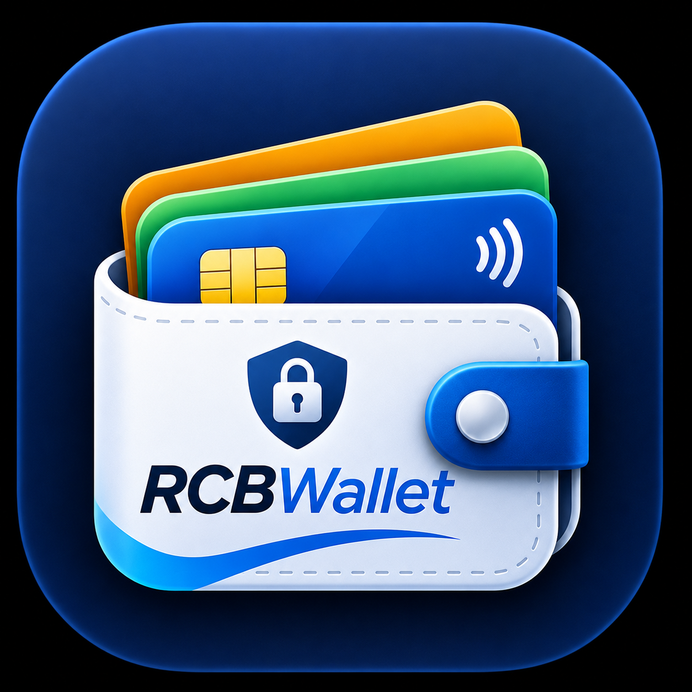

<p align="center">
  
</p>

# RCBWallet – an independently maintained fork

RCBWallet is an independently maintained fork of
[**Wallet**](https://github.com/sidhant947/Wallet), a Flutter app created by
**Sidhant** ([@sidhant947](https://github.com/sidhant947)) for storing credit,
debit, loyalty and identity cards locally on an Android device.

This fork is maintained by **Rananjaya**. It is **not** the original project,
and it is not affiliated with or endorsed by the original author. All credit
for the original application goes to Sidhant and the upstream contributors.

| | |
| --- | --- |
| Application name | RCBWallet |
| Android application ID | `com.rananjaya.rcbwallet` |
| Current version | `1.0.0+1` (versionName `1.0.0`, versionCode `1`) |
| Upstream repository | <https://github.com/sidhant947/Wallet> |
| Upstream application ID | `com.sidhant.wallet` |
| Forked from upstream version | `1.0.42+45` |
| Licence | GNU Affero General Public License v3.0 ([LICENSE](LICENSE)) |

> [!WARNING]
> **Not yet audited.** The security and privacy features described below are
> inherited from upstream and have **not** been independently audited or
> verified for this fork. Do not store real card information in RCBWallet
> until a security review has been completed.

---

## Purpose

The upstream author has announced that development of the Flutter version of
Wallet is paused and that the project will move to native Kotlin
(upstream's note: *"V1.0.42 is last update until the kotlin app development is
finished. New App will be published with V2.0.0 tag when ready."*).

RCBWallet continues to maintain the existing Flutter implementation under its
own application ID and its own version history.

## About the app (inherited from upstream)

The upstream project describes Wallet as a privacy-first, offline card
manager. According to the upstream code and documentation it:

- Stores cards, passes and identity documents in a local SQLite database,
  with sensitive fields encrypted with AES-256-GCM using a key held in
  Android secure storage.
- Has no `INTERNET` permission in release builds.
- Uses Argon2id password-based key derivation for encrypted backups (`.wbk`)
  and password-protected QR sharing.
- Supports biometric/device authentication at start-up, `.pkpass` import and
  Google Wallet link import.

These are descriptions of the code's intent, not verified guarantees.

## Modifications in this fork

Compared with upstream `1.0.42+45`:

- Renamed the app to **RCBWallet** (launcher label, `MaterialApp` title,
  splash screen text, fastlane title).
- Changed the Android `applicationId` and `namespace` from
  `com.sidhant.wallet` to `com.rananjaya.rcbwallet`, and moved
  `MainActivity.kt` to the matching Kotlin package.
- Started an independent version history at `1.0.0+1`.
- Release signing reads only from a local, git-ignored
  `android/key.properties`; release builds fail if it is missing or invalid
  and never fall back to the debug key. Added `android/key.properties.example`.
- In-app "Star" and "Report Error" links now point to this fork's repository.
  The sponsorship link still points to the original author.
- Replaced the upstream launcher icon with custom RCBWallet branding (see
  [Branding](#branding)).

Wallet functionality (encryption, key management, database, authentication,
backup/restore, card storage, permissions) has not been changed.

Because the application ID differs, RCBWallet installs alongside the upstream
Wallet app and cannot update it or read its data.

## Branding

RCBWallet uses its own icon, which replaces the upstream Wallet icon. It is
fork-specific artwork added by the fork maintainer and is not part of the
upstream project. Adding it does not change the licence of the original
application or of the code.

- Source artwork: [`assets/branding/rcbwallet_icon.png`](assets/branding/rcbwallet_icon.png)
  (1254×1254). This file is not bundled into the app.
- Android launcher icons (`android/app/src/main/res/mipmap-*`) and the
  F-Droid/fastlane store icon are generated from that artwork.
- On Android 8+ the adaptive icon is zoomed in so the artwork's built-in
  rounded tile is hidden by the launcher's own mask. With circular masks the
  wallet's lower corners are slightly trimmed.
- Android 13 themed (monochrome) icons are not provided yet, so themed
  launchers show the full-colour icon.
- The fastlane feature graphic and screenshots are still upstream's and have
  not been updated.

## Building

Requirements: Flutter (stable, see `environment` in `pubspec.yaml`),
JDK 17 and the Android SDK.

```bash
flutter pub get
flutter analyze

# Debug build
flutter build apk --debug

# Release build
flutter build apk --release
```

Outputs are written to `build/app/outputs/flutter-apk/`.

### Release signing

1. Create your own upload keystore (never reuse someone else's).
2. Copy `android/key.properties.example` to `android/key.properties` and fill
   in your values. Place the keystore where `storeFile` points (relative to
   `android/app/`).
3. Never commit `key.properties` or keystore files; both are git-ignored.

Debug builds do not need `android/key.properties`. Release builds (APK and
App Bundle) **fail** with an explanatory error if `key.properties` is missing,
incomplete, still contains the `CHANGE_ME` placeholders, or points to a
keystore file that does not exist. Release builds are never signed with the
debug key.

### Versioning

RCBWallet uses `MAJOR.MINOR.PATCH+BUILD` in `pubspec.yaml`:

- **MAJOR** – breaking changes
- **MINOR** – new backward-compatible features
- **PATCH** – bug fixes
- **BUILD** – Android `versionCode`; must increase for every distributed
  release

Flutter maps `MAJOR.MINOR.PATCH` to Android `versionName` and `BUILD` to
`versionCode`. Split-per-ABI APKs use `versionCode * 100 + abiCode`.

## Contributing

See [CONTRIBUTING.md](CONTRIBUTING.md) and the
[Code of Conduct](CODE_OF_CONDUCT.md). Please report issues with RCBWallet on
[this repository](https://github.com/Rananjaya/RCBWallet/issues), not upstream.

## Licence

RCBWallet is free software licensed under the
**GNU Affero General Public License, version 3** (AGPL-3.0), the same licence
as the upstream Wallet project. See [LICENSE](LICENSE).

The original work is by Sidhant and the upstream contributors; their copyright
is retained. Modifications in this fork are by Rananjaya and are released
under the same licence. This program is distributed WITHOUT ANY WARRANTY; see
the licence for details.
